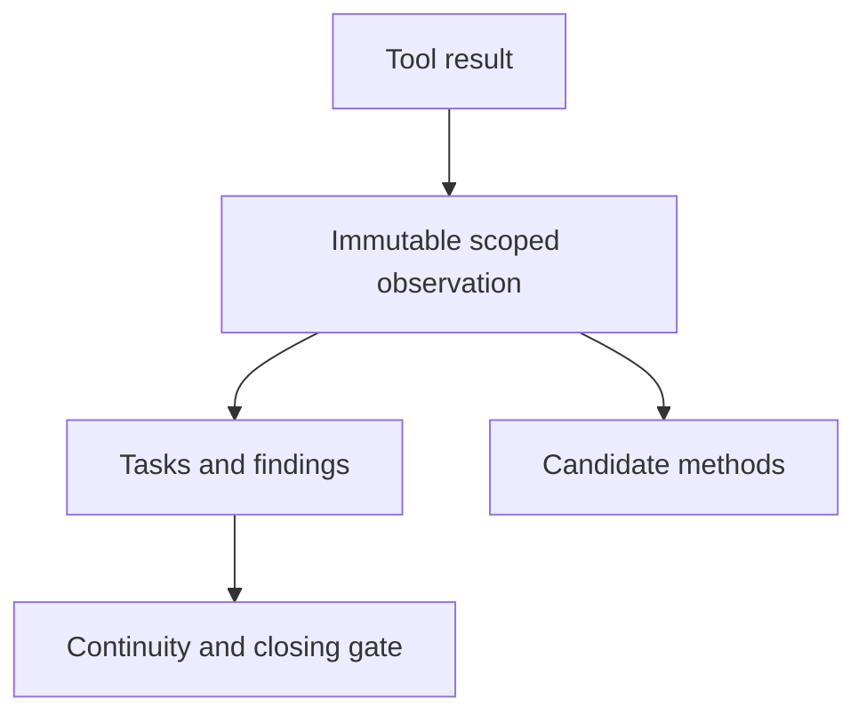

# Architecture

The core is one-way: a host turns a tool call into an observation, the stores
own the truth, and everything the model sees is derived from them.

## Two stores, two jobs

| Store | Holds | Why not one file |
|---|---|---|
| `knowledge.sqlite` | sessions, observations, knowledge, reviews, audit log | Written on every tool call; must stay small and fast, and it is read by the learning loop |
| `platform.sqlite` | missions, stages, findings, finding evidence and citations, sources, chunks, approvals, checkpoints | Engagement data outlives a project scope and is read by different code paths |

`StorePort` (`src/types.ts`) is the seam: the core depends on the port, not on a
database, so a test can hand it a stub and a host can hand it the real store.

## Modules and the invariant each one enforces

| Module | Enforces |
|---|---|
| `index.ts` | Re-exports the host-neutral core surface so hosts import one module without runtime coupling |
| `types.ts` | Shared interfaces, `DEFAULT_CONFIG`, learning categories, skill domains, and the `StorePort` boundary |
| `platform-types.ts` | Engagement stage order (`STAGES`), mission/finding/source shapes, and `ENTITY_TYPES` vocabulary |
| `skill-trace.ts` | Host-neutral `SkillTrace` and `SkillActivation` types describing which skills loaded or were skipped |
| `paths.ts` | Resolves `HARNESS_HOME` and `HARNESS_STATE_ROOT` outside host directories so stores outlive hosts |
| `observation-id.ts` | Derives deterministic observation IDs from `[sessionId, toolCallId]` using a prefix-free JSON hash |
| `store.ts` | SQLite knowledge store: transactional writes, immutable observations, scope isolation, and operator-rule authority over learned facts |
| `platform-store.ts` | Transactional engagement ledger: ordered stages, scope approval gates, independent finding verification with distinct negative controls, FTS search, and secret redaction |
| `tasks.ts` | Locked read-modify-write task tree with stale-lock recovery, bounded depth, dependency validation, reason-required blocks, and successful-evidence closure |
| `engagement-workflow.ts` | Immutable typed artifacts with alias-safe root confinement, versioned report snapshots, reviewed-before-restitution, post-restitution two-process cleanup (with retry/supersede), and bounded capitalization |
| `investigation.ts` | Pure signal functions (excluding `cyber_process` non-`read` actions from stagnation), hypothesis confirmation with distinct negative controls, non-blank block reasons, locked `InvestigationStore`, and `investigationBlock` formatting |
| `phases.ts` | Tool-derived offensive phase detection, transition directives, surface attack vectors, and the unconditional Counter-Logic Gauntlet |
| `capsule.ts` | Derives session continuity (`capsule`) with deduplicated observations and evaluates `closingGate` blockers from store state alone |
| `context.ts` | Selects operator rules under `operatorBudget` (foundational discipline ahead of target/dated keys) and separates learned knowledge |
| `skills.ts` | Locked learned-method lifecycle (`SkillUpdater`): 2-session and ≥0.75 confidence activation, deactivation on failure, idle archiving (including `global`), and identifier-free global promotion |
| `routing.ts` | Deterministic weighted keyword router (`routeFor`, `routingTable`), word-boundary/anti-noise matching, and declared method catalogue (`EXTERNAL_METHODS`, `HOST_METHODS`, `SHIPPED_METHODS`) |
| `lessons.ts` | End-of-session extraction prompt, proposal parser, evidence-gated application, and guarded `publishToolImprovements` journal updates |
| `memory-ranking.ts` | Bilingual NFD/FTS5-aligned tokenization, synonym query expansion, fragment deduplication, and TF-IDF-style candidate ranking |
| `process.ts` | Launches and tracks detached supervised commands (`spawnTraced`), verifies full trace hashes (`verifiedOutcome`), and manages `ProcessRegistry` locks and archiving |
| `process-supervisor.cjs` | Standalone process-group supervisor writing nonce-bound terminal result files and exact hashed `traceBytes` independently of the host |
| `process-evidence.ts` | Helpers to normalize background process handoffs and record/verify linked final process observations |
| `capture.ts` | Visual attestation framing (`isFramed`), canonical hex/decimal root-window exclusion (`assertNotRoot`), and plain-path capture destinations |
| `tool-registry.ts` | Locked registry for proposed/validated/active custom scripts (`argv` and `command` invocation, distinct positive/negative tests, path/script-header scanning) |
| `tool-catalog.ts` | Static security binary notes (`TOOL_NOTES`), `SECURITY_SHORT_TERMS`, and synonym expansion (`expandSecurityTerms`) |
| `tool-gap.ts` | Matches declared assessment objectives against discovered inventory without treating keyword matches as coverage |
| `installable.ts` | Static installable security tool catalog (`CATALOG`), executable `isPresent` checks, and non-interactive `ensure` wrappers |
| `techniques.ts` | Structured technique cards (`TECHNIQUES`) and capability gaps (`techniqueGaps`) across offensive phases |
| `osv.ts` | Bounded, stable normalizer (`summarizeOsv`) and `OSV_ECOSYSTEMS` list for OSV vulnerability queries |
| `cve-sources.ts` | Multi-source CVE/exploit lookup (`queryNvd`, `querySearchsploit`, `multiSourceLookup`) with bounded reads and flag-injection guards |
| `reference-search.ts` | Bounded read-only FTS search across operator-provided reference SQLite indexes with `-wal`/`-shm` plain-path checks and redaction |
| `sources.ts` | SSRF-guarded HTTP(S) and root-confined folder/file ingestion (`SourceSynchronizer`) producing immutable source chunks |
| `osint-ingest.ts` | Pure line/httpx/JSON dump parser (`planIngest`) validating hosts/IPs/URLs and stripping credentials before entity/relation upsert |
| `coverage-roles.ts` | Per-asset-kind checklist templates (`ASSET_STEPS`, `assetSteps`) with `Object.hasOwn` lookup safety |
| `coverage-profiles.ts` | Bounded deep coverage checklists and contracts (`COVERAGE_PROFILES`, `COVERAGE_CONTRACTS`) for mobile, cloud, harness, and gaps |
| `util.ts` | Scope slugging (`scopeFor`), SHA-256 hashing, secret redaction (`redactText`/`redact`), learning-text guards, `atomicWrite`, and `assertPlainPath` |

## Where the host plugs in

`opencode/plugin.ts` and the modules next to it (`permissions.ts`, `display.ts`, `workflow-tools.ts`, `ledger-tools.ts`, `paths.ts`) form the host boundary. They register:

- `context` — injects continuity, the routing table and the closing gate; starts
  the background lesson extraction for pending sessions.
- `tool.execute.after` — records the observation, including failures.
- `cyber_finding create` — refuses a finding whose enforced method was not successfully loaded (unless `HARNESS_ROUTER=off`).
- tools `cyber_*` — tasks, findings, sources, missions, approvals, processes,
  memory, methods, reviews, captures, toolbox, investigation, entities, CVEs, reporting, capitalization, cleanup.
- `skill.transform` — serves all authored `.opencode/skills/` procedures and active learned methods across active session scopes and `instanceCwd`.
- `prompt` — retains request text for routing in the following context hook.

The native context event omits prompt text. The prompt hook retains the latest
request per session; the ledger also routes on the proposed finding. Failed
skill loads never count as procedure use. Unknown requests receive the compact
routing table.

## The learning loop

Quiet sessions are extracted by the digest of their observation snapshot. New
observations make a resumed session eligible again. Failures may be retried
after a cooldown and are never recorded as empty successful extractions.
Proposals still pass the ordinary evidence gates before becoming knowledge or
candidate methods. A pinned verifier is exclusive; fallback providers require
explicit configuration. Time and accepted response length are bounded, while
the pinned stateless API exposes no server-side output-token ceiling.

## The investigation arbiter

A catalogue of methods is inert; a model left alone loops on one tool, leaves
hypotheses untested and concludes before covering the surface. `investigation.ts`
is the arbiter that reads the state and tells the model so.

- The signal functions (`detectStagnation`, `directives`, `assembleInvestigation`)
  are pure: they read the observation stream, the task tree and the clock.
- `HypothesisTracker` and `CoverageMap` hold what the model declares. A hypothesis
  confirms only with a successful reproduction and a negative control that observe
  different outputs; a successful observation alone does not confirm it; a refuted
  one is closed and is not revisited. A surface is tested only with evidence, blocked only with a reason.
- `InvestigationStore` persists both per scope (locked, atomic, read on every use),
  so a resumed session finds them.
- The host assembles the state on every context turn and injects the resulting
  block after the closing gate. `investigationBlock(ds)` returns an empty string
  only when given an empty directive list `[]`; `directives(state)` emits
  stagnation, coverage, and phase directives conditionally while always appending
  the Counter-Logic Gauntlet. `detectStagnation()` excludes `cyber_process`
  non-`read` actions (`run`, `list`, `stop`, `prune`), which intentionally record
  `evidenceSuccess: false`.
- The same signals are hard blockers, not only advice: the capsule carries an
  `investigation` summary and `closingGate` refuses a conclusion while a declared
  surface is untouched, a hypothesis is stale, or addressed coverage is under the
  threshold. A surface blocked with a reason counts as addressed; a closed
  engagement owes none of this. An individual finding stays free — the gate is on
  concluding, not on recording one claim.
- `cyber_investigation` is the tool the model uses to declare hypotheses and
  coverage and to read the directives. It is bookkeeping: its own calls do not
  count as operational proof (`OWN_TOOL`).

## Rules for changing the core

- Read the module and its tests before editing; the invariants live in the
  tests, not only in the prose.
- A new invariant needs a negative control: a test that shows the refusal.
- No host name, no target name, no secret in `src/` (`npm run check`).
- The standalone runner discovers `test/opencode-*.cjs` suites.

## Durable execution and verification

`process-supervisor.cjs` owns one process group independently of the host and
writes a durable terminal result. `process.ts` verifies all trace bytes and
keeps unknown legacy identities distinct from successful outcomes. Task
mutations hold a lock for the whole update. Verification payloads bind a
finding content hash to fresh reproduction and negative-control observations.
The prompt hook provides request text when the native context event omits it.

## Rapports et restitution

`engagement-workflow.ts` utilise `platform.sqlite` : artefacts immuables,
snapshots, génération liée par empreintes, revue, restitution puis nettoyage
vérifié. Les transitions et leurs événements sont transactionnels ; un verrou
optimiste évite les démarrages concurrents. Il n’y a pas de troisième base.
`PlatformStore.finish` contrôle le rapport dans la transaction qui ferme l’étape.
Une reprise de validation conserve les checkpoints et invalide les vérifications
courantes. Les nouvelles preuves doivent suivre cette reprise.

`opencode/workflow-tools.ts` applique les décisions opérateur à la frontière
native. Les procédures `.opencode/skills/` décrivent rédaction et capitalisation.
Le générateur Python reste optionnel, hors du runtime Node. Le hook `prompt`
alimente le routage, les échecs de chargement ne satisfont pas une méthode.
