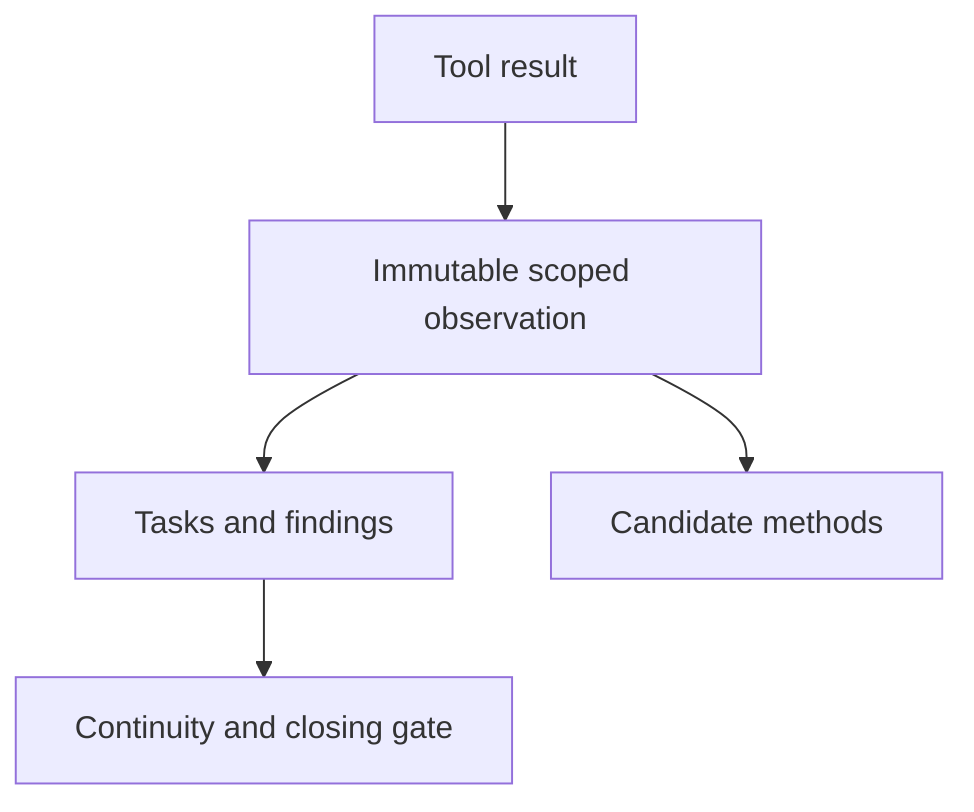

# Architecture

The core is one-way: a host turns a tool call into an observation, the stores
own the truth, and everything the model sees is derived from them.

## Two stores, two jobs

| Store | Holds | Why not one file |
|---|---|---|
| `knowledge.sqlite` | sessions, observations, knowledge, reviews, audit log | Written on every tool call; must stay small and fast, and it is read by the learning loop |
| `platform.sqlite` | missions, stages, findings, finding evidence and citations, sources, chunks, approvals, checkpoints | Engagement data outlives a project scope and is read by different code paths |

`StorePort` (`src/types.ts`) is the seam: the core depends on the port, not on a
database, so a test can hand it a stub and a host can hand it the real store.

## Modules and the invariant each one enforces

| Module | Enforces |
|---|---|
| `store.ts` | An observation is written once and never edited; a finding cites only evidence from its own scope; operator rules override inferred knowledge |
| `platform-store.ts` | A mission takes its stages in order; a scope is approved before work is dispatched; a finding is verified by an observation that is not its own evidence |
| `tasks.ts` | Mutations are locked; `complete` takes evidence ids resolved by the host; `block` requires a reason |
| `capsule.ts` | The returning session gets the exact state: open steps, blocked steps with reasons, the mission stage, pending approvals, commands the harness still owns. `closingGate` answers "are we done?" from that state alone |
| `skills.ts` | A method becomes active only with support from two sessions and confidence ≥ 0.75; a global method is promotion-only, evidence-free, identifier-free, and visible from every project (project shadows global) |
| `routing.ts` | One route per request, weighted triggers, an anti-noise guard (a single hit on a long text is not a route) |
| `lessons.ts` | The extractor proposes; the ordinary gates dispose. A proposal without a successful observation is refused |
| `process.ts` | A long command is owned: full output to a named file, detached lifetime, stop by id |
| `capture.ts` | A visual attestation is one window, framed, never the desktop; a recorded trace is rendered as the terminal view a report can print |
| `memory-ranking.ts` | Operator rules keep a reserved budget (`operatorModelChars`) and learned facts never crowd them out |
| `util.ts` | The scope slug (`project-<24 hex>`), hashing, and the text redaction used before anything reaches an audit row |

## Where the host plugs in

`opencode/plugin.ts` and `opencode/workflow-tools.ts` form the host boundary. They register:

- `context` — injects continuity, the routing table and the closing gate; starts
  the background lesson extraction for pending sessions.
- `tool.execute.after` — records the observation, including failures.
- `cyber_finding create` — refuses a finding whose enforced method was not successfully loaded.
- tools `cyber_*` — tasks, findings, sources, missions, approvals, processes,
  memory, methods, reviews, captures.
- `skill.transform` — serves authored project procedures and active learned methods.
- `prompt` — retains request text for routing in the following context hook.

The native context event omits prompt text. The prompt hook retains the latest
request per session; the ledger also routes on the proposed finding. Failed
skill loads never count as procedure use. Unknown requests receive the compact
routing table.

## The learning loop

Quiet sessions are extracted by the digest of their observation snapshot. New
observations make a resumed session eligible again. Failures may be retried
after a cooldown and are never recorded as empty successful extractions.
Proposals still pass the ordinary evidence gates before becoming knowledge or
candidate methods. A pinned verifier is exclusive; fallback providers require
explicit configuration. Time and accepted response length are bounded, while
the pinned stateless API exposes no server-side output-token ceiling.

## Rules for changing the core

- Read the module and its tests before editing; the invariants live in the
  tests, not only in the prose.
- A new invariant needs a negative control: a test that shows the refusal.
- No host name, no target name, no secret in `src/` (`npm run check`).
- The standalone runner discovers `test/opencode-*.cjs` suites.

## Durable execution and verification

`process-supervisor.cjs` owns one process group independently of the host and
writes a durable terminal result. `process.ts` verifies all trace bytes and
keeps unknown legacy identities distinct from successful outcomes. Task
mutations hold a lock for the whole update. Verification payloads bind a
finding content hash to fresh reproduction and negative-control observations.
The prompt hook provides request text when the native context event omits it.

## Rapports et restitution

`engagement-workflow.ts` utilise `platform.sqlite` : artefacts immuables,
snapshots, génération liée par empreintes, revue, restitution puis nettoyage
vérifié. Les transitions et leurs événements sont transactionnels ; un verrou
optimiste évite les démarrages concurrents. Il n’y a pas de troisième base.
`PlatformStore.finish` contrôle le rapport dans la transaction qui ferme l’étape.
Une reprise de validation conserve les checkpoints et invalide les vérifications
courantes. Les nouvelles preuves doivent suivre cette reprise.

`opencode/workflow-tools.ts` applique les décisions opérateur à la frontière
native. Les procédures `.opencode/skills/` décrivent rédaction et capitalisation.
Le générateur Python reste optionnel, hors du runtime Node. Le hook `prompt`
alimente le routage, les échecs de chargement ne satisfont pas une méthode.
